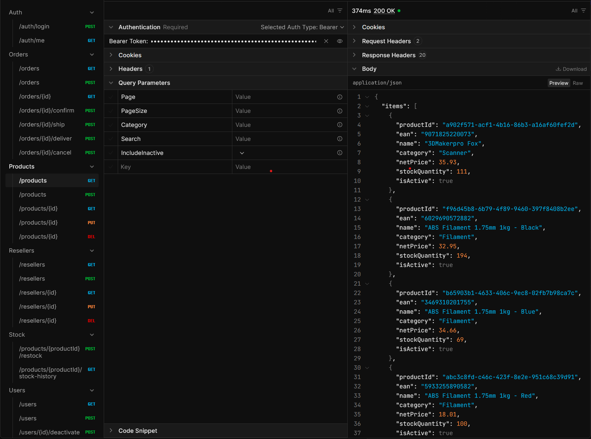

# Reseller Order API


A REST API for managing products, resellers, orders and stock for a maker-tools
distributor (3D printers, filament, scanners, spare parts). Built with ASP.NET Core,
Entity Framework Core and PostgreSQL.



## Features
- **Products, resellers and orders** with paging, filtering and search
- **Order lifecycle:** Pending → Confirmed → Shipped → Delivered (or Cancelled), with illegal transitions rejected
- **Stock tracking:** confirming an order reserves stock, cancelling a confirmed order restores it, and every change is recorded as a stock movement
- **Concurrency-safe:** two simultaneous orders can never sell the same last units
- **JWT authentication** with three roles (Admin, SalesRep, Reseller) and ownership rules, so a reseller only sees their own orders
- **Integration tests** that run against a real PostgreSQL database
- **Interactive API documentation** (Scalar) and a health check endpoint

## Tech stack
ASP.NET Core · EF Core · PostgreSQL · JWT · BCrypt · Serilog · xUnit · Testcontainers · Docker

## Getting started

Requirements: .NET SDK, Docker, and the EF Core tool (`dotnet tool install --global dotnet-ef`).

```bash
docker compose --profile app up --build
```

In GitHub Codespaces, Docker's internal networking can prevent containers from reaching each other.
There, use the host-network variant instead:

```bash
docker compose up -d
docker compose -f docker-compose.host.yml up --build
```

### Demo accounts (Development only)
| Role | Email | Password |
|---|---|---|
| Admin | admin@example.com | Admin123! |
| SalesRep | sales@example.com | Sales123! |
| Reseller | reseller@example.com | Reseller123! |

Log in with `POST /auth/login`, then send the returned token as `Authorization: Bearer <token>`.

| Role | Can do |
|---|---|
| Admin | Everything, including user management |
| SalesRep | Products, resellers, orders (including status changes) and stock |
| Reseller | Read products, create and read their own orders |

## Running the tests
The integration tests start the API against a throwaway PostgreSQL container
(Testcontainers), so Docker must be running:

```bash
dotnet test
```

## Architecture
The solution has three projects, each with one job:

- **Core:** entities, DTOs and service interfaces. It depends on nothing else.
- **Infrastructure:** EF Core, the database context, migrations and the service implementations.
- **Api:** controllers, authentication, error handling and startup.

Controllers only translate between HTTP and the services. All business rules live in the
services, which keeps them testable.

## Design decisions
- **Price snapshots:** an order line copies the product's price when the order is created, so later price changes never rewrite history.
- **Stock is reserved on confirmation, not on creation.** Pending orders reserve nothing.
- **One transaction per status change:** the new status, the stock updates and the stock movements are saved together, or not at all.
- **Optimistic concurrency:** products and orders carry a version token (PostgreSQL's `xmin`). If two requests change the same row at once, the second gets a 409 and can retry. A database check constraint also guarantees that stock never goes below zero.
- **404 instead of 403 for other resellers orders**, so the API doesn't reveal which orders exist.
- **Soft delete for products:** discontinued products stay visible in old orders. A reseller with orders or user accounts cannot be deleted.
- **Same error for wrong email and wrong password** at login, so the API never reveals which emails exist.

The full design (entities, business rules and endpoints) is in [docs/design.md](docs/design.md).

## Configuration
Development settings (including a placeholder JWT key and the demo users) are committed for
convenience and only work locally. For a real deployment, set `Jwt__Key` and the database
connection string as environment variables. Never commit real secrets.

## Known limitations
- Deactivating a user blocks new logins, but a token they already hold stays valid until it expires (60 minutes).
- There are no refresh tokens, password reset or order editing.
- Prices are in a single currency with no tax handling.
- The API is not deployed anywhere. It is meant to be run locally.

## Possible next steps
- Reporting endpoints (top products, revenue per reseller)
- Order editing
- A small front end